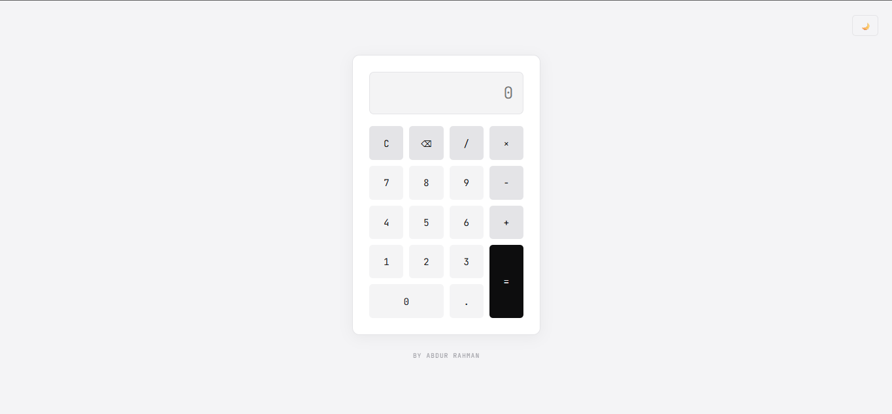
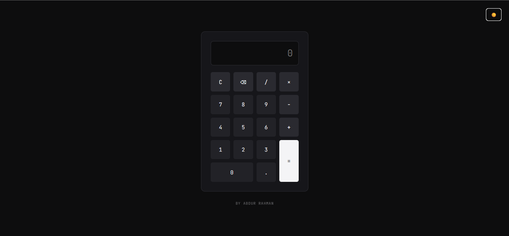

# Minimalist Calculator

A compact browser calculator built with **HTML, CSS, and vanilla JavaScript**. It supports basic arithmetic, decimal input, keyboard entry, clearing, and deleting the last character.

## Features

- Addition, subtraction, multiplication, and division
- Decimal values
- Clear and backspace controls
- Keyboard input
- Light and dark themes
- Input checks for common invalid sequences

## Run locally

Open `calculator/calculator.html` in a browser. Keep `calculator/asset/` alongside the HTML file so the stylesheet and script can load.

## Built with

- HTML5
- CSS3
- Vanilla JavaScript

## Screenshot

